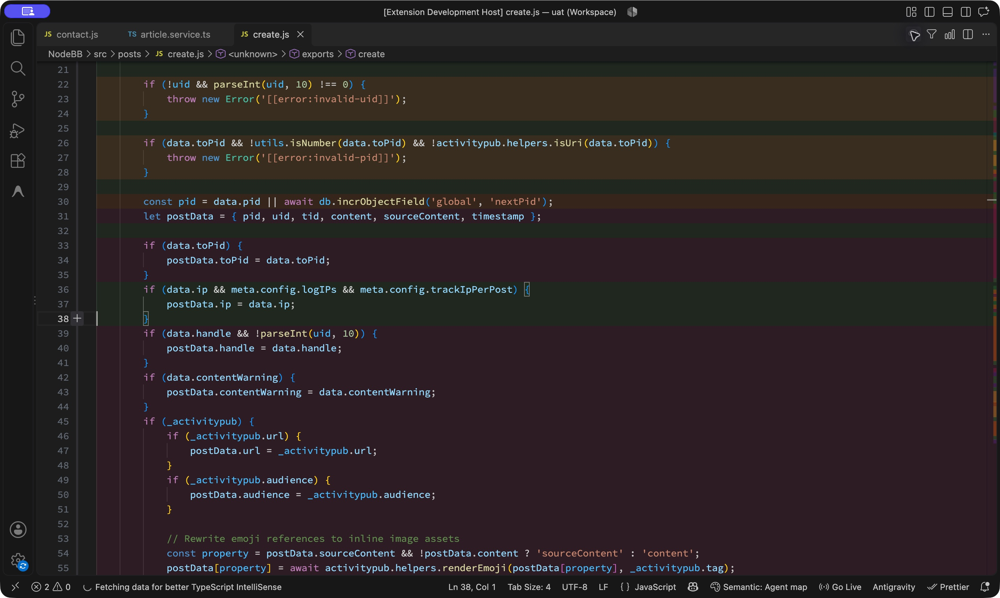

# Semantic Code Highlighter

Semantic Code Highlighter turns a JavaScript or TypeScript file into a subtle, responsibility-based map. Whole-line background bands distinguish business logic, validation, utilities, data, infrastructure, external I/O, and transformations—so you can understand an unfamiliar file before reading every line.

Install the pre-release from the [Visual Studio Marketplace](https://marketplace.visualstudio.com/items?itemName=umarf2212.semantic-code-highlighter), or search for **Semantic Code Highlighter** in VS Code Extensions.

## Try it in GitHub Codespaces

[**Open the demo in GitHub Codespaces →**](https://codespaces.new/umarf2212/semantic-code-highlighter/tree/codex/codespaces-demo?quickstart=1)

The demo branch prepares Hackathon Starter, RealWorld, Express and NodeBB at the commits used in our UAT, builds and installs this development extension, and opens a [guided demo workspace](demo/README.md). Four curated files load responsibility bands automatically without an API key or a model call. Only those four files have prepared agent maps; other files can be explored with the optional local provider.

Use the two-core machine for this reading demo. Codespaces usage follows your GitHub account's quota and budget; the setup does not change billing settings, request secrets, or publish ports. Stop the codespace when finished. See [Codespaces setup and troubleshooting](docs/wiki/CODESPACES.md).


The source is never modified. Ambiguous or low-confidence code stays uncolored instead of receiving a persuasive guess.

## Generate a map with your coding agent

1. Open the codebase in VS Code and run **Semantic Code: Prepare Agent Analysis**.
2. In your normal Codex, Claude Code, or other coding-agent session, ask: **“Read `.semantic-code/SPEC.md`, inspect the codebase, and write `.semantic-code/map.json`.”**
3. Keep `semanticCode.provider` set to `agent` (the default). Open a supported file and run **Semantic Code: Analyze Current File**, or use **Analyze Workspace** to load a batch.
4. Scan the bands and hover for the model's explanation. The status bar identifies the provider as **Agent map**.

The extension makes no model call in this workflow. Your coding agent uses its own session and can inspect related implementations across the repository. The extension supplies exact AST boundaries and validates the JSON against the current source. After source changes, prepare the metadata again and ask the agent to update the map. Preparation preserves an existing `map.json`.

From this development repository, preparation can also run as `npm run prepare:agent -- /path/to/codebase`. The CLI exports up to 500 eligible files, 256 KB each, with up to 10,000 regions per file. The VS Code command respects the configured workspace/file/region limits (defaults: 50 files, 256 KB, 220 regions). Both report excluded or over-limit files. See [the agent workflow](docs/wiki/AGENT_WORKFLOW.md).

For an immediate offline heuristic preview, explicitly select the `local` provider.

## Real-repository UAT

The [feasibility assessment and UAT report](docs/uat/2026-11-05/README.md) includes 21 real VS Code screenshots from Hackathon Starter, RealWorld, Express and NodeBB, before/after comparisons, responsibility filtering, failure cases, and reproduction artifacts. The local analysis core was exercised on 1,055 files.

The report evaluates the development working tree, including unreleased agent-map features; it does not describe every feature of the Marketplace build. Demonstration maps were authored and assessed by the same agent, so they are not an independent accuracy or reading-speed benchmark.



## Responsibility legend

| Responsibility | Default color | Intended meaning |
| --- | --- | --- |
| Business logic | Green `#2E7D32` | Domain rules, decisions, calculations, and workflows |
| Validation | Amber `#F9A825` | Preconditions, schema checks, permissions, and rejected state |
| Utility | Blue `#1565C0` | Generic reusable helpers and scheduling machinery |
| Data | Teal `#00838F` | Types, schemas, models, constants, and data representation |
| Infrastructure | Purple `#6A1B9A` | Configuration, adapters, platform APIs, and application wiring |
| External I/O | Orange `#EF6C00` | Databases, files, queues, APIs, and services |
| Transformation | Magenta `#AD1457` | Mapping, normalization, parsing, and representation changes |
| Mixed responsibility | Grey `#616161` | Residual lines in a broad region with several responsibilities |

Colors and opacity are configurable. One eligible region owns each colored line, so nested blocks do not stack translucent backgrounds.

## Convenience features

- Responsibility lens: temporarily show only one responsibility that is present in the current file.
- File summary: see each responsibility's share of colored lines and jump to the first matching region.
- Bounded workspace analysis: explicitly analyze up to a configured file limit, with cancellation and cache reuse.
- Analyze on open/save: optional and off by default; only saved files are eligible.
- Stable cache: classifications are reused only while source, provider, model, prompt, ontology, classifier, and relevant project context still match.
- Visible status: the status bar shows the provider, whether the map is visible, and any active lens during the current session.

## Optional local and OpenAI providers

The `local` provider is private, deterministic, immediate, and requires no credentials. Its semantic reach is intentionally narrower than a coding agent that reads implementations.

The optional `openai` provider uses the Responses API with strict structured output for model-based, advisory responsibility classification. To use it:

1. Run **Semantic Code: Set OpenAI API Key**. The key is stored in VS Code SecretStorage, not settings.
2. Set `semanticCode.provider` to `openai` for the workspace or folder.
3. Run analysis manually and review the first-send disclosure.

On an OpenAI cache miss, the extension sends the current source, a workspace-relative path (or basename for a loose file), language and AST-region metadata, and bounded project context. Requests use `store: false`. Secret-looking, generated, minified, dependency, build-output, oversized, and unsupported files are rejected before classification. See the canonical [privacy record](docs/wiki/PRIVACY.md).

## Commands

| Command | Purpose |
| --- | --- |
| Prepare Agent Analysis | Export the coding-agent spec, region metadata, and JSON schema |
| Analyze Current File | Load or classify and render the active supported file |
| Analyze Workspace | Analyze a chosen workspace root within configured limits |
| Focus Responsibility Lens | Show all responsibilities or one category present in the file |
| Show Responsibility Summary | Show proportions and navigate by responsibility |
| Toggle Visualization | Hide or restore existing bands without classifying |
| Clear Session Analysis | Remove all in-memory maps and active lenses |
| Clear Cached Analysis | Remove persisted classifications and all in-memory maps |
| Set / Forget OpenAI API Key | Manage the optional provider credential in SecretStorage |

Settings are under `semanticCode.*`. The most useful controls are `provider`, `model`, `opacity`, `minimumConfidence`, `cacheEnabled`, `analyzeOnOpen`, file/region/workspace limits, local workspace concurrency, and per-category `colors`.

## Run from source

```sh
npm install
npm run check
npm test
npm run compile
```

Contributor tooling requires Node.js 22.

Open this repository in VS Code and press `F5`. The launch configuration opens `test/fixtures/demo-workspace`; run **Analyze Current File** on `order-service.ts`.

To build an installable package:

```sh
npm run package:vsix
code --install-extension artifacts/semantic-code-highlighter.vsix
```

## Product boundaries

This is an experimental pre-release and every classification is advisory. The extension currently supports JavaScript and TypeScript syntax only. The local provider favors precision over coverage; the OpenAI provider costs tokens and transmits eligible source only after opt-in disclosure. Responsibility boundaries can still be debatable, especially on dense single lines.

Architecture maps, dependency graphs, smells, Git/test/runtime overlays, custom ontologies, extra languages, and more providers remain deferred until they prove they improve code-reading convenience without weakening the core map.

## LLM-readable project memory

[`llms.txt`](llms.txt) and the version-controlled [`docs/wiki/`](docs/wiki/README.md) capture the north star, ontology, region ownership, prompt/schema versions, privacy, cache identity, UX decisions, QA, roadmap, and architecture decisions. Documentation describes shipped behavior, not speculative machinery.

See [CONTRIBUTING.md](CONTRIBUTING.md) for development expectations. Licensed under [MIT](LICENSE).

## Semantic quality on tangled code

The OpenAI prompt follows implementations and data flow within the supplied file, treats names and paths as hints, and chooses one dominant responsibility. For competing inline regions, the model now decides which region best describes the whole line; the chosen region supplies the color and hover. Multi-line uncertainty still shields parent colors.

Try `test/fixtures/tangled-workspace/utils.ts` with the OpenAI provider. This synthetic example interleaves parsing, guards, domain pricing hidden behind misleading helper names, file writes, and handler registration. A separate benchmark checks 16 selected lines across three path/name variants:

```sh
npm run eval:semantic
# With OPENAI_API_KEY already set in your environment:
npm run eval:semantic -- --provider openai --model YOUR_MODEL
```

The default evaluation is local and offline. OpenAI evaluation sends three variants of the synthetic fixture and may make one repair retry per variant. It does not read your application code or the extension's stored key. See [evaluation methodology and limitations](docs/wiki/SEMANTIC_EVALUATION.md).
