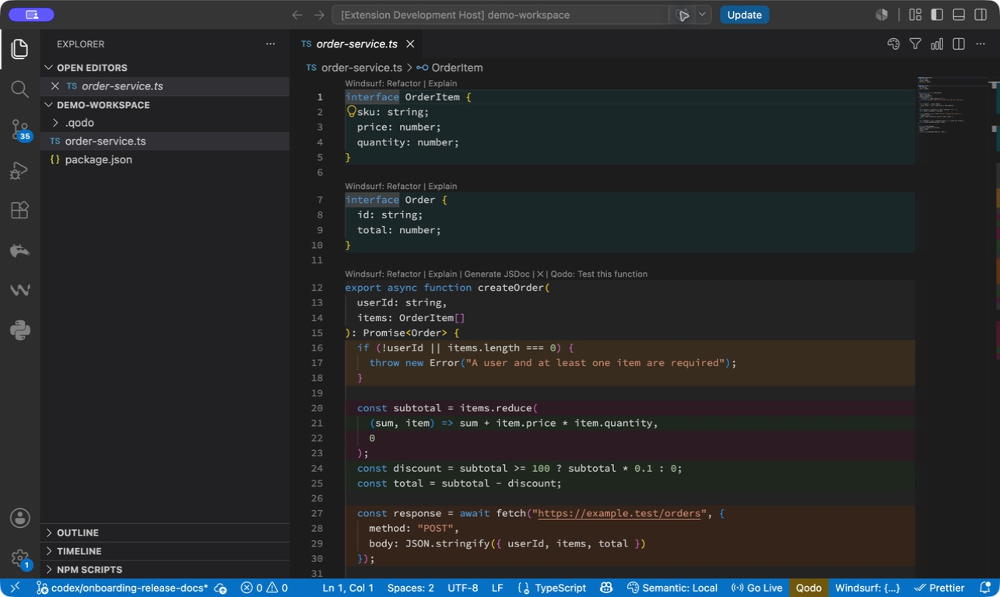

# Semantic Code Highlighter

Semantic Code Highlighter turns a JavaScript or TypeScript file into a subtle, responsibility-based map. Whole-line background bands distinguish business logic, validation, utilities, data, infrastructure, external I/O, and transformations—so you can understand an unfamiliar file before reading every line.



The source is never modified. Ambiguous or low-confidence code stays uncolored instead of receiving a persuasive guess.

## Get a useful map in one minute

1. Install the extension or [run it from source](#run-from-source).
2. Open a saved `.js`, `.jsx`, `.ts`, or `.tsx` file.
3. Run **Semantic Code: Analyze Current File** from the Command Palette or click the color-map icon in the editor title.
4. Scan the background bands. Hover a band for its responsibility, qualitative confidence, rationale, and structural breadcrumb. Privacy-safe cached OpenAI results omit the prior model rationale.
5. Click **Semantic: Local** in the status bar to hide or restore the map instantly.

The local classifier is the zero-setup default. It is deliberately conservative and leaves code uncolored when naming, paths, and syntax do not provide enough evidence.

## Responsibility legend

| Responsibility | Default color | Intended meaning |
| --- | --- | --- |
| Business logic | Green `#2E7D32` | Domain rules, decisions, calculations, and workflows |
| Validation | Amber `#F9A825` | Preconditions, schema checks, permissions, and rejected state |
| Utility | Blue `#1565C0` | Generic reusable helpers and scheduling machinery |
| Data | Teal `#00838F` | Types, schemas, models, constants, and data representation |
| Infrastructure | Purple `#6A1B9A` | Configuration, adapters, platform APIs, and application wiring |
| External I/O | Orange `#EF6C00` | Databases, files, queues, APIs, and services |
| Transformation | Magenta `#AD1457` | Mapping, normalization, parsing, and representation changes |
| Mixed responsibility | Grey `#616161` | Residual lines in a broad region with several responsibilities |

Colors and opacity are configurable. One eligible region owns each colored line, so nested blocks do not stack translucent backgrounds.

## Convenience features

- Responsibility lens: temporarily show only one responsibility that is present in the current file.
- File summary: see each responsibility's share of colored lines and jump to the first matching region.
- Bounded workspace analysis: explicitly analyze up to a configured file limit, with cancellation and cache reuse.
- Analyze on open/save: optional and off by default; only saved files are eligible.
- Stable cache: classifications are reused only while source, provider, model, prompt, ontology, classifier, and relevant project context still match.
- Visible status: the status bar shows the provider, whether the map is visible, and any active lens during the current session.

## Local and OpenAI providers

`semanticCode.provider` defaults to `local`, which is private, deterministic, immediate, and requires no credentials. Its semantic reach is intentionally narrower.

The optional `openai` provider uses the Responses API with strict structured output for model-based, advisory responsibility classification. To use it:

1. Run **Semantic Code: Set OpenAI API Key**. The key is stored in VS Code SecretStorage, not settings.
2. Set `semanticCode.provider` to `openai` for the workspace or folder.
3. Run analysis manually and review the first-send disclosure.

On an OpenAI cache miss, the extension sends the current source, a workspace-relative path (or basename for a loose file), language and AST-region metadata, and bounded project context. Requests use `store: false`. Secret-looking, generated, minified, dependency, build-output, oversized, and unsupported files are rejected before classification. See the canonical [privacy record](docs/wiki/PRIVACY.md).

## Commands

| Command | Purpose |
| --- | --- |
| Analyze Current File | Classify and render the active supported file |
| Analyze Workspace | Analyze a chosen workspace root within configured limits |
| Focus Responsibility Lens | Show all responsibilities or one category present in the file |
| Show Responsibility Summary | Show proportions and navigate by responsibility |
| Toggle Visualization | Hide or restore existing bands without classifying |
| Clear Session Analysis | Remove all in-memory maps and active lenses |
| Clear Cached Analysis | Remove persisted classifications and all in-memory maps |
| Set / Forget OpenAI API Key | Manage the optional provider credential in SecretStorage |

Settings are under `semanticCode.*`. The most useful controls are `provider`, `model`, `opacity`, `minimumConfidence`, `cacheEnabled`, `analyzeOnOpen`, file/region/workspace limits, local workspace concurrency, and per-category `colors`.

## Run from source

```sh
npm install
npm run check
npm test
npm run compile
```

Contributor tooling requires Node.js 22.

Open this repository in VS Code and press `F5`. The launch configuration opens `test/fixtures/demo-workspace`; run **Analyze Current File** on `order-service.ts`.

To build an installable package:

```sh
npm run package:vsix
code --install-extension artifacts/semantic-code-highlighter.vsix
```

## Product boundaries

This is an experimental pre-release and every classification is advisory. The extension currently supports JavaScript and TypeScript syntax only. The local provider favors precision over coverage; the OpenAI provider costs tokens and transmits eligible source only after opt-in disclosure. Responsibility boundaries can still be debatable, especially on dense single lines.

Architecture maps, dependency graphs, smells, Git/test/runtime overlays, custom ontologies, extra languages, and more providers remain deferred until they prove they improve code-reading convenience without weakening the core map.

## LLM-readable project memory

[`llms.txt`](llms.txt) and the version-controlled [`docs/wiki/`](docs/wiki/README.md) capture the north star, ontology, region ownership, prompt/schema versions, privacy, cache identity, UX decisions, QA, roadmap, and architecture decisions. Documentation describes shipped behavior, not speculative machinery.

See [CONTRIBUTING.md](CONTRIBUTING.md) for development expectations. Licensed under [MIT](LICENSE).
