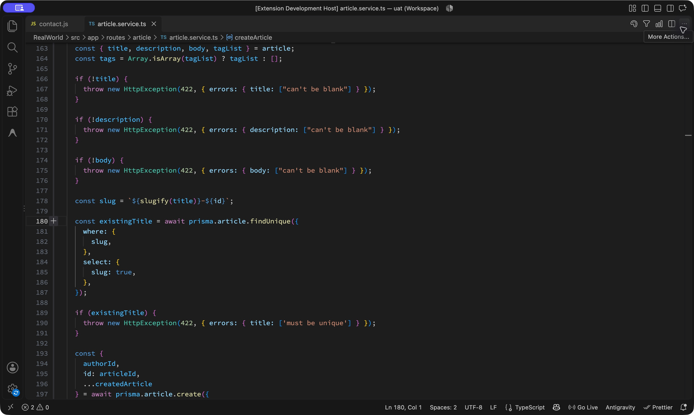
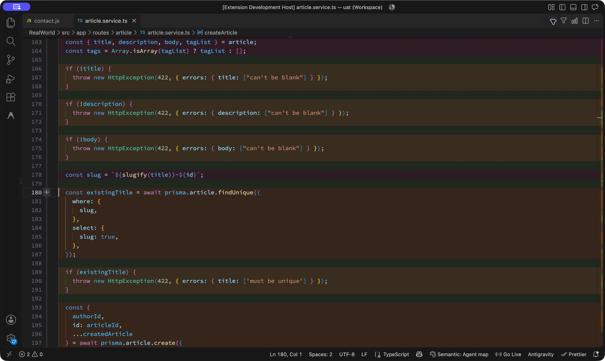
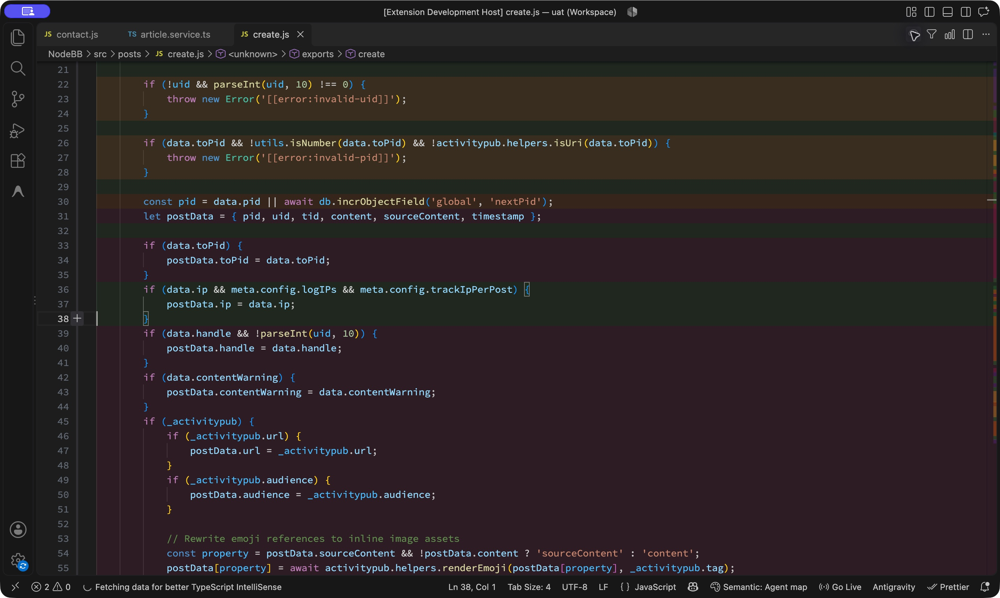
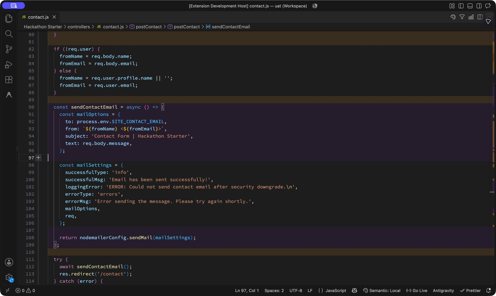
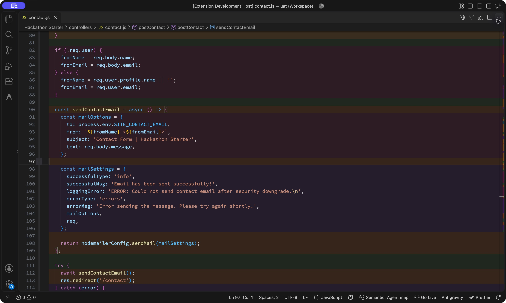
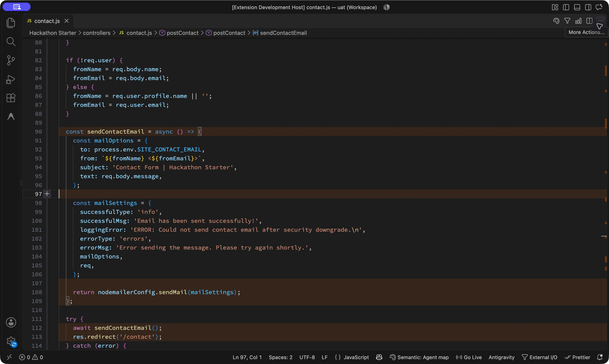
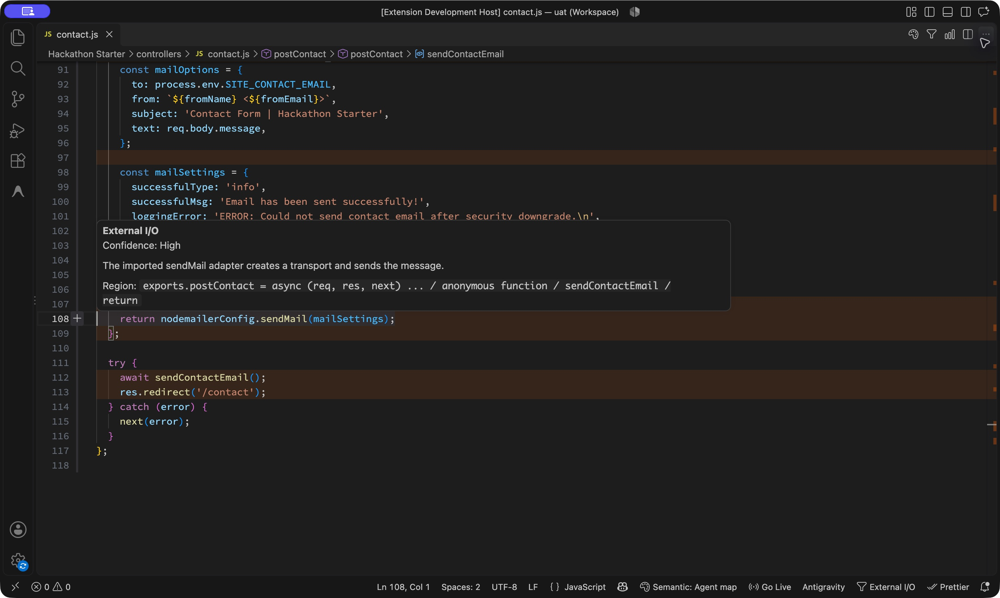
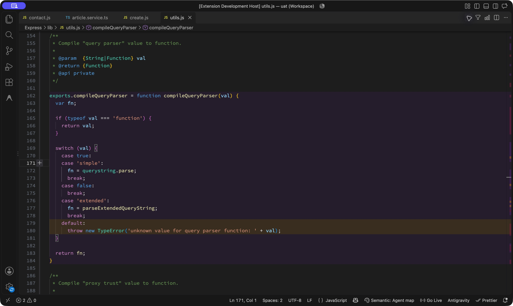

# Feasibility assessment and real-repository UAT

**Verdict: useful today as an agent-assisted reading aid; keep developing it, but first-use setup, semantic reliability and large-file coverage need work before a broad release.**

The strongest interaction is opening unfamiliar code, locating a band, checking its explanation, and filtering to one responsibility. The extension preserves normal editing and does not need a separate architecture panel. The visual and loading infrastructure is feasible. Producing and maintaining trustworthy semantic maps is the harder product problem.

This is an agent-driven UAT of the current working tree on 2026-11-05. It is not a human comprehension study. The same agent selected files, authored the demonstration maps and assessed their usability; their correctness is not an independent benchmark. No improvement in reading time, market demand or willingness to pay has been measured.

**Implementation availability:** this publication contains the report and test artifacts. The tested working tree includes uncommitted development features, including the agent provider, that are not part of the base commit or Marketplace release. Publishing this report does not release those features. The reproduction scripts require that tested development implementation; use the source checksums in [run-manifest.json](evidence/run-manifest.json) to identify it. They cannot reproduce the agent examples from the older base commit alone.

## Scope and environment

- VS Code **1.140.0**, macOS arm64; Node **22.23.1**; extension **0.1.0** loaded from this repository in an actual Extension Development Host.
- Base extension commit: `12cfe2dc6b4b537e9b5a842cb985540de34258ff`, with the user's pre-existing uncommitted implementation changes. This evaluates the working version, not a claim about the Marketplace build.
- Four shallow public GitHub clones under ignored `.qa/uat/repos/`. No dependencies were installed and no application servers or repository scripts were run.
- Four files loaded and visually inspected in VS Code; **340 regions** and **9 inline ownership choices** authored and accepted by the extension's real validator.
- A separate headless sweep exercised the real extractor, local classifier and line ownership logic on **1,055 files**. This was not 1,055 editor screenshot checks or independent accuracy judgments.
- Default confidence **0.5**, opacity **0.12**, category colors and region limit **220**. Screenshot setup uses editor font 14, line height 21, Dark Modern and hidden sidebars, set only in the UAT workspace.
- An isolated-profile launch did not expose an inspectable window. The recorded UI run used a separate development-host window in the existing VS Code instance. Other installed extensions are visible; Problems counts include cloned-project configuration/dependency diagnostics and do not represent highlighter failures.
- Both `local` and `agent` providers were exercised. The extension's optional OpenAI provider was not tested. No OpenAI API key was configured for this UAT.
- Screenshots are unaltered captures of the real VS Code window, including negative cases. No rendering mockups were used.

The repositories were selected for mixed responsibilities, long modules, callbacks, framework code and cross-file helper calls. This is not a judgment that these projects are generally disorganized. Express also provides a useful well-established framework comparison.

## Repository evidence

| Repository | Pinned commit | Files discovered | Locally analyzed | Over 220 regions | Other skipped | Editor example |
| --- | --- | ---: | ---: | ---: | ---: | --- |
| [Hackathon Starter](https://github.com/sahat/hackathon-starter) | `fb53b17c28c99e6fbcd78106930c6e9b403eb9ec` | 56 | 46 | 10 | 0 | `controllers/contact.js`, 117 lines, 60 regions |
| [RealWorld](https://github.com/gothinkster/node-express-realworld-example-app) | `30b68e1e881462b2f4164ea09ab4c4f5699c7b0b` | 39 | 37 | 0 | 2 | `src/app/routes/article/article.service.ts`, 652 lines, 112 regions |
| [Express](https://github.com/expressjs/express) | `43fca52d28a422c8be48fd489cbd4f2d6152bab6` | 142 | 124 | 17 | 1 | `lib/utils.js`, 271 lines, 108 regions |
| [NodeBB](https://github.com/NodeBB/NodeBB) | `2f5e2f04508a54e7ad329ad4c881a98a036c808f` | 953 | 848 | 102 | 3 | `src/posts/create.js`, 102 lines, 60 regions |
| **Total** | | **1,190** | **1,055** | **129** | **6** | **4 mapped editor examples** |

Other skipped files comprise four with no meaningful regions and two rejected by the source filter. These counts describe this harness's JS/TS discovery, not every file in each repository or the extension's bounded workspace command. The harness deliberately sweeps beyond the UI's default 50-file batch limit.

Raw results, categories, source-region metadata, classification timings and validation outcomes are in [repository-results.json](evidence/repository-results.json). All four selected agent maps validated. Local median classification plus line-map times ranged from approximately **0.08–0.71 ms per file**; parsing, VS Code rendering, map authoring and cache lookup are excluded. These timings are not a user-facing latency promise.

## What the screenshots demonstrate

The relevant colors are amber for validation, green for domain workflow/policy, orange for external I/O, magenta for transformation, and purple for infrastructure. Category meanings also appear in hover and summary text.

### RealWorld: find checks and persistence inside a long service

Task: find where article creation rejects input, constructs the slug, queries for duplicates and starts persistence. The source spans 652 lines; its directory name alone does not identify each operation.

Before:



With the **agent provider**: required-field checks are amber, the slug conversion is magenta, and database access is orange. The green strips between them come from the enclosing workflow region; they are also evidence of the visual-noise issue described below.



### NodeBB: distinguish admissibility, policy and data projection

Task: locate invalid identifier guards, the database counter, and the policy deciding whether to attach an IP address. Guards are amber, allocation is orange, metadata projection is magenta, and the IP policy is green. This is the clearest example of different responsibilities interleaved in one function.



[Before](screenshots/10-nodebb-before.png) and [the later persistence section](screenshots/12-nodebb-io-and-unknown.png) are also captured. The two plugin filter calls at lines 60 and 82 deliberately remain uncolored because installed plugin bodies can change their behavior. That is a useful uncertainty signal, not missing screenshot content.

### Hackathon Starter: find a side effect hidden behind a helper

Task: find the actual email-sending operation, including the call through `nodemailerConfig.sendMail`. The imported implementation was inspected before authoring the map.

The **local provider** paints that call purple as infrastructure and leaves the `sendContactEmail()` call uncolored. It misses the operational purpose:



The **agent provider** distinguishes sender projection, adapter feedback settings and orange email delivery:



The **External I/O lens** removes the other categories while keeping code visible. It answers “where can this handler contact another system?” without restructuring the file:



Keyboard-invoked hover (`Cmd+K`, `Cmd+I`) explains the chosen category and displays confidence and a region breadcrumb:



The [responsibility summary](screenshots/07-contact-summary.png) gives textual category meanings and colored-line shares. Selecting Validation moved the editor to line 52 and enabled the validation lens. Percentages describe colored lines, not code quality, importance or semantic accuracy.

### Express: configuration and rejection are different operations

Task: distinguish selecting a query-parser implementation from rejecting an unsupported setting. The agent map colors configuration purple and the rejected default case amber.



[Before](screenshots/15-express-before.png) and [the same view toggled off](screenshots/17-toggle-hidden.png) provide comparison. This is useful even in a conventional utility module, though a uniformly parsing-focused file offers less additional value than a mixed workflow.

## Executed acceptance scenarios

| Scenario | Observed result | Outcome / evidence |
| --- | --- | --- |
| First analysis with default agent provider and no map | No bands; error instructs the user to prepare and generate `map.json` | Safe failure; **onboarding issue**. [01](screenshots/01-first-run-missing-map.png) |
| Prepare Agent Analysis from the VS Code command | RealWorld exported 37 files; 2 skipped; opened SPEC.md; existing map preserved byte for byte | **Pass**. [19](screenshots/19-prepare-agent-analysis.png) |
| Load four authored maps | All four source hashes, complete region assignments, versions and ownership choices accepted; bands visible | **Pass**. [04](screenshots/04-contact-agent-provider.png), [09](screenshots/09-realworld-agent-provider.png), [11](screenshots/11-nodebb-agent-provider.png), [16](screenshots/16-express-agent-provider.png) |
| Offline provider on contact code | Immediate map appears, but email delivery is classified as infrastructure | Functional pass; **semantic failure**. [03](screenshots/03-contact-local-provider.png) |
| Focus External I/O | Other colored categories disappear; source stays visible; lens status appears | **Pass**. [05](screenshots/05-contact-external-io-lens.png) |
| Inspect hover using keyboard | Textual category, confidence, rationale and breadcrumb agree with the orange sending line | **Pass**. [06](screenshots/06-contact-hover-explanation.png) |
| Navigate with responsibility summary | Validation selection focuses the lens and jumps to the first matching region, line 52 | **Pass**. [07](screenshots/07-contact-summary.png) |
| Toggle bands off and on via status bar | Decorations disappear and return; Hidden state is visible | **Pass**, but hidden state loses provider identity. [17](screenshots/17-toggle-hidden.png) |
| Edit a mapped document | One unsaved space immediately removes stale bands and map status | **Pass**. [13](screenshots/13-edit-clears-colors.png) |
| Analyze after the edit | Old source hash rejected with a stale-map error | **Pass**. [14](screenshots/14-stale-map-rejected.png) |
| Undo edit and analyze again | Dirty indicator clears; original map loads successfully | **Pass**; clone has no tracked source diff |
| Replace map artifact | Displayed map invalidates; manual analysis reloads the replacement | **Pass**; observed while reviewing the contact map |
| Unknown plugin behavior | Lines 60 and 82 in NodeBB remain uncolored without inheriting a persuasive parent category | **Pass**. [12](screenshots/12-nodebb-io-and-unknown.png) |
| Analyze large Express `response.js` | 410 regions exceed the default 220; warning offers a setting change; no partial map | Expected rejection; **coverage issue**. [18](screenshots/18-large-file-limit.png) |
| Agent workspace analysis with a deliberately partial map | 1 mapped, 0 cache hits, 2 filtered, **36 failed**; no invented missing entries | **Pass** for completeness reporting; missing entries are intentional. [20](screenshots/20-agent-partial-workspace-result.png) |
| Offline workspace analysis of RealWorld | **37 mapped, 0 cache hits, 2 filtered, 0 failed** | **Pass**. [21](screenshots/21-local-workspace-success.png) |

## Issues to address before broad adoption

| Priority | Finding and evidence | Practical change |
| --- | --- | --- |
| **P1** | Default first use ends in a missing-map error. A user must discover preparation, use an external agent, generate JSON, then return to analysis. | Offer Prepare and Open Instructions directly from this state; make the optional offline preview discoverable. |
| **P1** | Local heuristics can convincingly color the wrong responsibility. The contact email call is a concrete example; the existing synthetic test also shows path sensitivity. | Label heuristic results clearly and validate improvements on a frozen, independently reviewed set of real files before presenting them as semantic understanding. |
| **P1** | The target use case includes large tangled files, but 129 of 1,190 discovered files exceed the default region limit. Express `response.js` is a direct UI reproduction. | Offer a bounded section/function analysis or a clear larger-file workflow; evaluate extraction cost and model limits before changing defaults. |
| **P1** | Agent maps must be generated and refreshed outside the extension. A complete source hash check catches edits to the file, but changes in related implementations can invalidate meaning without changing that hash. | Make map completeness and refresh scope visible. Establish a practical incremental regeneration workflow before promising effortless repository-wide understanding. |
| **P2** | Blank separators and residual parent lines receive colors, producing alternating strips that can suggest more boundaries than useful operations. | Evaluate neutral whitespace and less prominent parent residual spans against the north star, with a visual-precedence ADR if behavior changes. |
| **P2** | Colors have no always-visible inline legend. Hover and summary provide text, but a first-time user must discover them. Color-vision and screen-reader usability were not established here. | Add a compact discoverable legend and preserve textual navigation; test with actual accessibility users and light/high-contrast themes. |
| **P2** | Hidden status reads “Semantic: Hidden” and loses the provider label, despite QA documentation expecting provider identity to remain visible. | Preserve provider identity when hidden. |
| **P2** | On the over-limit path, a “Mapping… Finding semantic regions” progress notification remained until its warning was dismissed. | Close analysis progress before waiting for acknowledgment of a skip warning. |

The strongest next investment is making trustworthy maps easy to obtain and maintain. Extra graphs, statistics and panels would not resolve these observed problems.

## Validation and limits of the conclusion

- [`npm run check`](evidence/check.txt): passed.
- [`npm test`](evidence/tests.txt): **21 files, 89 tests passed**.
- [`npm run compile`](evidence/compile.txt): passed.
- [`npm run package:vsix`](evidence/package.txt): passed; 8 packaged files, approximately 1.14 MB compressed. VSCE warned that the production JavaScript bundle is 4.02 MB. This creates a package; install-from-VSIX and Marketplace distribution were not separately tested.
- [Existing local synthetic evaluation](evidence/local-fixture-evaluation.txt): 56.25%, 62.5%, 62.5% accuracy across three 16-line naming/path variants. This is a narrow synthetic rubric, not real-repository accuracy.
- [Existing checked-in agent reference evaluation](evidence/agent-fixture-evaluation.txt): 16/16. This checks reference-map loading and rendering semantics; it is not a blind model evaluation.

No OpenAI request/cost/latency, automatic-on-save, cache-hit UI repetition, cancellation-in-flight, missing-credential, light-theme, high-contrast or formal screen-reader acceptance study was performed. Existing automated tests cover portions of those behaviors; they do not substitute for those missing UI/provider checks. There was no observed highlighter crash in this run.

A useful follow-up human test would assign the same concrete tasks with and without the bands: locate a validation guard, identify all persistence effects, explain a policy branch and identify uncertainty. Counterbalance task order and measure correct answers, time and confidence. Current evidence supports the usefulness of the navigation mechanism, not a quantified productivity claim.

## Reproduce the demonstration

From the development repository, clone the four linked repositories into the paths above, and check out their exact commits from the table. Install this project's own dependencies if needed. Do not install the sample repositories' dependencies.

```sh
node docs/uat/2026-11-05/collect-evidence.mjs
node docs/uat/2026-11-05/author-maps.mjs
node docs/uat/2026-11-05/collect-evidence.mjs
npm run compile
```

The collector writes AST metadata, exports a request for one selected file per repository, sweeps local classifications and validates any existing map. Its first run can record missing maps; the final run records the authored maps. `author-maps.mjs` materializes the explicit semantic decisions for these pinned source snapshots. These are demonstration artifacts; the script is not a generic semantic classifier.

Open `.qa/uat/uat.code-workspace` in VS Code with this repository as `--extensionDevelopmentPath`, or make a multi-root workspace containing the four clone roots. Use `semanticCode.provider: agent` and the default confidence, opacity and colors. Open each example and run Analyze Current File. The maps are also archived in [maps/](maps/), and all 21 original captures are in [screenshots/](screenshots/).

An archived [workspace file](workspace.code-workspace) resolves the clone paths relative to this report:

```sh
code --new-window --extensionDevelopmentPath="$PWD" docs/uat/2026-11-05/workspace.code-workspace
```

[run-manifest.json](evidence/run-manifest.json) records source and screenshot SHA-256 checksums and verifies that all four clones retained unchanged tracked source.

To repeat the offline workspace result, select `local`, run Analyze Workspace and choose RealWorld. Restore `agent` for the authored screenshots. Only the selected four files have agent maps; workspace analysis will explicitly report other files as missing.

The test workspace and clones are retained under `.qa/uat/` for inspection and excluded from packaging. No product implementation was changed by this UAT. The report, maps, evidence collector and QA documentation are the deliverables.
